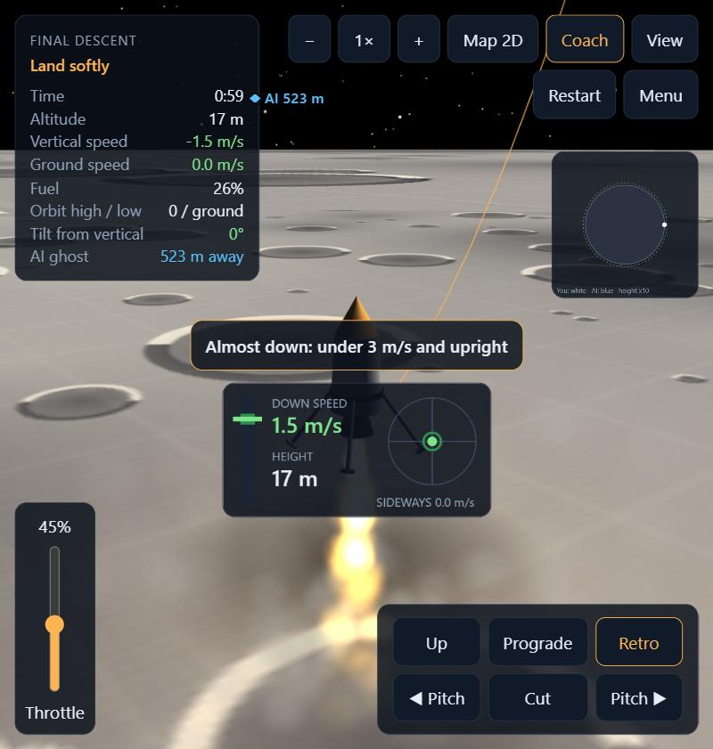
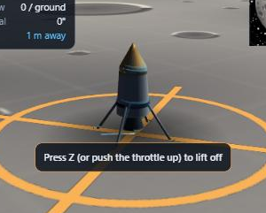
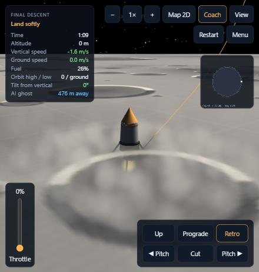
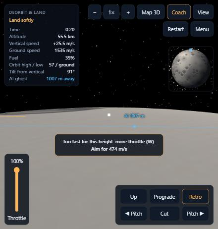

# Moon Pilot — work report, 10 November 2026

**Play link for testers:** https://surfrgames.github.io/moonpilot-play/

This covers the feedback round: graphics, effects, legs, landing clarity, AI visibility, maps,
hosting. Everything below is in the hosted build.

## What you asked for and what was done

| Your point | What changed |
|---|---|
| Graphics too dull | Craters now have lit and shaded rims and surface relief; stronger sunlight with darker shadows; Earth and a sun glare in the sky; 5,000 stars in two sizes and tints; a new wide detail layer so the ground is not blank from orbit. |
| No visual effects | Exhaust particles and nozzle glow; the engine lights the ground; dust blown outward when you fire near the surface; a dust ring on touchdown; fireball, debris, flash and a scorch mark on a crash; camera shake. |
| Objects don't react | Rocket squashes on touchdown; legs swing down and fold; wreck disappears in the explosion; a shadow under the rocket grows and fades with height. |
| Landing legs don't work | Root cause: the ground detail was drawn 4–5 m above the real surface, so the legs were buried. Ground layers are now at ground level. Legs fold in flight, deploy below 1.5 km on descent, and `G` toggles them. |
| Landing feels confusing | Landing panel below 3 km: down-speed needle against a green safe band, height, and a sideways-drift target. The coach, the shadow and engine light also show how close the ground is. "Touchdown!" message and a longer pause before the score. |
| Can't see the AI | A blue "AI · distance" label follows the ghost and slides to the screen edge when it is out of view; HUD shows distance to the AI; the AI is on both maps. |
| 2D and 3D map, top right | Map panel with three modes on the `Map` button or `M`: 2D (your path, the AI's path, your predicted orbit, lowest-orbit ring; heights stretched 10×), 3D (the whole Moon rendered live with both rockets and trails), off. |
| Host it | Published to GitHub Pages from a new public repository, `SurfrGames/moonpilot-play`, which holds only the web build. `bash tools/deploy-pages.sh "note"` republishes. |

Also added: pause (`P` or `Esc`).

## Screenshots

## How it was checked
- Flew Final Descent to a soft landing with a scripted pilot: landing panel, dust ring and result
  screen all appeared.
- Cut the engine to force a crash at 66 m/s: explosion and scorch appeared, result screen followed.
- Started Launch to Orbit and Deorbit & Land: legs on the pad, 3D map and AI label rendered.
- No errors in the browser console in any run.
- The public link returned the page and every script, the 3D library, the AI data and the icon.

## Not done or not verified
- Checked only in a narrow preview pane (phone-like layout). The wide desktop layout of the new
  panels has not been looked at.
- The four-mission robot test was not repeated after this round. Physics and coach were not
  touched, but it is not re-proven.
- The hosted link was checked for loading, not played through in a browser.
- Speed on low-end phones is unmeasured; the new lighting and particles cost more than before.
- Sound has no new effects yet (touchdown, explosion, warnings).
- These changes are not committed. Branch `feat/tutorial` has `index.html`, `game.js`, `world.js`
  modified and `tools/deploy-pages.sh`, `docs/` and `.agents/` new.

## Things to know about the public link
- Anyone with the link can play, and the game's JavaScript is readable, as with any web game.
  The AI trainer and the private repository are not published.
- The page is a snapshot. It changes only when the publish script is run again.

## More feature ideas, in the order I would build them
1. **Daily challenge with a share card** — one new launch site a day, a picture of your score to post.
2. **Online leaderboard** — per mission and per daily challenge.
3. **Sound pass** — touchdown thud, explosion, low-fuel and sink-rate warnings, quiet music.
4. **Landing targets** — a marked pad with a precision bonus, so "land anywhere" becomes "land there".
5. **Hard mode** — coach off and less fuel for a score multiplier.
6. **Your own ghost** — race your best run as well as the AI's.
7. **Live AI opponent** — run the trained network in the browser so the AI reacts instead of replaying.
8. **Rocket skins and trails** — the natural supporter pack.
9. **Real terrain** — hills and boulders near the landing site.
10. **Rendezvous mission** — catch the AI in orbit.
11. **Achievements, photo mode, cockpit camera, tilt steering on phones.**

## What to ask your friends
- Could you land on the first three tries? Where did you get stuck?
- Did the coach's text make sense? Was anything on screen in the way?
- Phone or laptop, and did it run smoothly?
